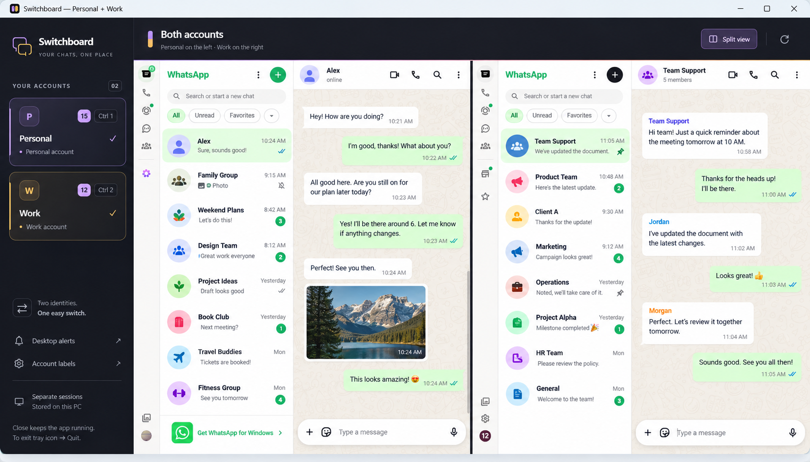
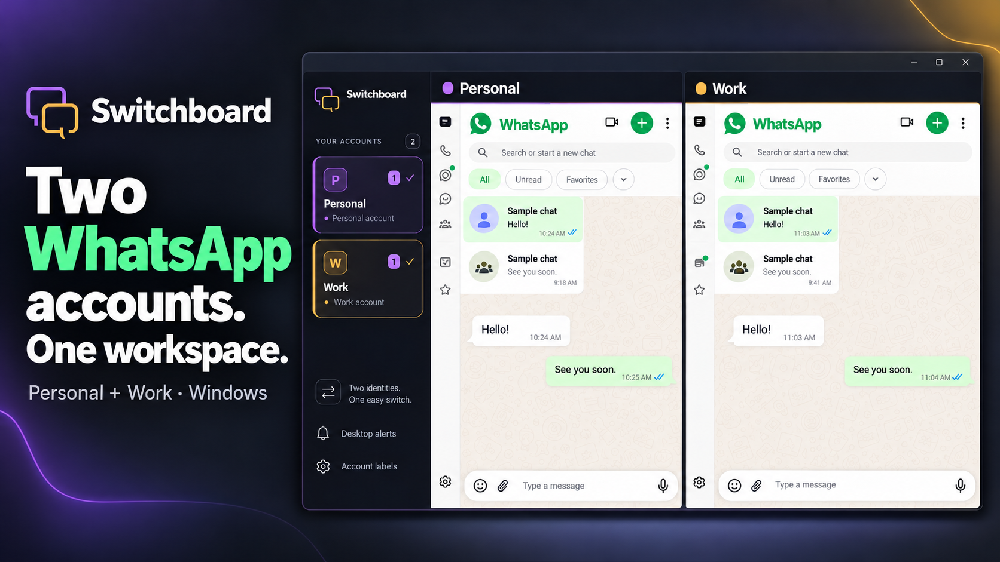

# Switchboard

**Two WhatsApp accounts. One workspace.**

Switchboard is a Windows desktop app that keeps **two WhatsApp Web accounts** in one labelled window. Each account has its own saved session, so Personal and Work stay easy to identify and switch between. Built with Rust, Tauri 2, and Microsoft Edge WebView2.



*Supplied illustrative preview with sample content. It is not a live account capture; the desktop app loads WhatsApp Web into two separate native panes.*

## Features

- **Separate sessions:** persistent Personal and Work profiles, with custom names and subtitles.
- **Single or split view:** switch accounts or keep both visible, with native zoom fitting the split panes.
- **Global shortcuts:** summon the app or jump to the next account reporting unread chats.
- **Account-aware alerts:** labelled Windows notifications that select the matching account and original conversation.
- **Tray indicators:** purple for Personal, amber for Work, with count information in the tooltip and menu.
- **Remembered workspace:** account/split mode, compact sidebar, window size, and shortcut choices survive restart.



*Supplemental brand illustration highlighting two WhatsApp accounts in one desktop workspace.*

## Build and run

This repository provides source code. No prebuilt installer is currently published.

On Windows, install Git, Node.js with npm, Rust **1.90+** with the MSVC toolchain, Visual Studio C++ Build Tools with the Windows SDK, and the WebView2 Runtime. See the [Tauri Windows prerequisites](https://v2.tauri.app/start/prerequisites/#windows) for setup instructions.

```powershell
git clone https://github.com/yazanbaker94/switchboard.git
cd switchboard
npm ci
npm run dev
```

To build the executable and an NSIS installer locally:

```powershell
npm run build
```

Build output is under `src-tauri/target/release/`; the installer is under `bundle/nsis/` within that directory.

### Development preview

For shell development, run `npm run demo` after `npm ci`, then open the [split view](http://localhost:4173/?view=split), [compact view](http://localhost:4173/?view=compact), or [shortcut settings](http://localhost:4173/?view=shortcuts). This utility uses a mock desktop bridge and fictional messaging panes. It does not connect to WhatsApp, register system shortcuts, or change browser permissions.

## Link your accounts

1. Select **Personal**, then use WhatsApp's **Linked devices → Link a device** on the corresponding phone to scan its QR code.
2. Select **Work** and link the second account using its separate QR code.
3. Open **Account labels** to rename the accounts and add optional subtitles.
4. For alerts, open **Desktop alerts** and choose **Allow notifications** for each account. This explicitly grants permission and reloads that account. Also enable **Turn on** inside WhatsApp if it reports that message notifications are off.

Each account has independent browser storage. Link the accounts in Switchboard even if they are already signed in through Chrome.

## Controls

| Control | Action |
| --- | --- |
| `Ctrl+1` / `Ctrl+2` | Select Personal / Work, including when an account pane has focus |
| `Ctrl+3` | Show both accounts |
| `Ctrl+Alt+W` | Bring the current workspace forward; hide it when already foreground |
| `Ctrl+Alt+U` | Select the next account reporting unread chats |
| `Ctrl+Q` | Quit completely |
| Close window | Hide to the tray and keep both sessions running |
| Sidebar toggle | Collapse the 232-pixel sidebar to a 72-pixel rail |
| Keyboard icon | Check shortcut availability, choose alternatives, or disable a shortcut |

Global shortcuts require Switchboard to be running. The keyboard panel offers `Ctrl+Alt+Space` for summon and `Ctrl+Alt+N` for next unread. If a shortcut is unavailable or interferes with your keyboard layout, choose an alternative or **Disabled**. An occupied replacement leaves the previous working shortcut active.

Unread counts come from WhatsApp's title indicator. Next unread tries the other account first, using the last single account when starting from split view. If no positive count is known, it brings the current workspace forward. `—` in the tray tooltip means the count is unavailable.

## Privacy and architecture

One native window hosts the bundled interface and two WhatsApp Web views. The account pages receive no Tauri shell-command permissions. Separate WebView2 profiles preserve each login, and switching views keeps the pages loaded. External links open in the system browser; downloads target the Windows Downloads folder.

Data is stored locally under `%LOCALAPPDATA%\com.switchboard.desktop`:

| Location | Contents |
| --- | --- |
| `profiles/personal`, `profiles/work` | Linked-session cookies and browser storage |
| `shell` | Interface browser storage, including account labels |
| `workspace.json` | Layout, shortcuts, normal logical window size, and maximized state |

Keep these directories private. Log out through WhatsApp or the phone's linked-device controls. Switchboard does not require a separate account or backend service.

Notifications require explicit per-account permission. The app relays notification titles and bodies to Windows, where normal notification previews and history apply. Unread events sent to the local interface contain only an account identifier and optional count; raw website titles are discarded. Optional local diagnostics may include filesystem paths and counts: review them before sharing. See [SECURITY.md](SECURITY.md).

## Validation and limits

The latest recorded core validation passed **33 Rust tests and 29 interface tests**, plus source and formatting checks. Windows checks at 125% scaling exercised separate authenticated sessions, labelled notification routing, foreground restoration, split composers, global summon/toggle, next unread, compact panels, and restart persistence. See [TESTING.md](TESTING.md) for scope and remaining coverage.

Switchboard is an unofficial wrapper and is not affiliated with WhatsApp or Meta. Compatibility depends on WhatsApp Web and WebView2; Chrome feature parity is not guaranteed. Calls, microphone/camera workflows, file handling, other display configurations, and long-idle/network recovery need broader testing. Windows notification settings, including Do not disturb, control alert presentation.

Contributions are welcome: [CONTRIBUTING.md](CONTRIBUTING.md). Licensed under [MIT](LICENSE).
